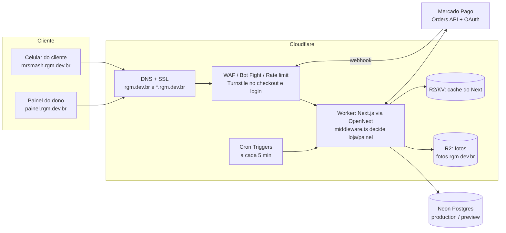

# Arquitetura: migração da Vercel para a Cloudflare

Plano para levar o RGM Pedidos da Vercel para a Cloudflare **antes do primeiro cliente real**, mantendo tudo que já
funciona (domínios por loja, Pix, webhook, fotos) e ganhando segurança, tarefas agendadas e custo menor.
Nada é desligado na Vercel até a Cloudflare estar testada e no ar — dá para voltar atrás em minutos.

> Status (11/nov/2026): **fases 1 e 2 prontas; fase 3 em teste.** Branch `feat/cloudflare-workers` no ar em
> https://rgm-pedidos-preview.raylanmiranda1.workers.dev (banco `preview`, Pix de teste), publicada pelo Workers Builds.
> Testado lá: cardápio, checkout, painel inteiro, Excel, token MP, webhook 401, cache dos estáticos e upload/exclusão
> de foto no R2. Domínios testados no runtime local. Worker: 2,6 MB comprimido, início em 15 ms.
> Ver "Decisões tomadas na fase 2" no fim.

---

## 1. Por que migrar

| | Vercel Hobby (hoje) | Vercel Pro | **Cloudflare Workers Paid** |
|---|---|---|---|
| Custo | grátis | US$ 20/mês | **US$ 5/mês** |
| Uso comercial (lojas recebendo pedidos/Pix) | ❌ proibido | ✅ | ✅ |
| Tarefas agendadas (cron) | 1×/dia | sim | **sim (Cron Triggers)** |
| Firewall / anti-bot / rate limit na borda | básico | básico | **WAF, Bot Fight Mode, Turnstile, regras de rate limit** |
| Armazenamento de fotos | Vercel Blob | Vercel Blob | **R2 (10 GB grátis, sem custo de saída)** |
| E-mail `@rgm.dev.br` | não | não | **Email Routing grátis** |

O plano **grátis** da Cloudflare não serve: limita cada acesso a **10 ms de CPU**, e as páginas do Next.js renderizadas
no servidor (cardápio, cozinha, relatórios, Excel) passam disso → erro. O **Workers Paid (US$ 5)** libera até 30 s por
acesso e inclui 10 milhões de acessos/mês (estimativa: dezenas de lojas, já contando a cozinha atualizando a cada 8 s).

---

## 2. Como fica (visão geral)

---

## 3. Peça por peça

| Peça | Hoje (Vercel) | Na Cloudflare | Trabalho |
|---|---|---|---|
| **Site (Next.js 16)** | Vercel Functions | **Workers** com o adaptador [`@opennextjs/cloudflare`](https://opennext.js.org/cloudflare) (Next 16 suportado) | config `open-next.config.ts` + `wrangler.jsonc`, flag `nodejs_compat` |
| **Roteamento por domínio** | `proxy.ts` | **`middleware.ts` no runtime Edge** — o OpenNext ainda não reconhece `proxy.ts` (roda em Node, que o Workers recusa). Nosso arquivo só lê host e cookie → compatível | renomear + `export const config` |
| **Domínios** | `*.rgm.dev.br` na Vercel | DNS do `rgm.dev.br` na Cloudflare (Universal SSL cobre `rgm.dev.br` e `*.rgm.dev.br`); rotas do Worker: `*.rgm.dev.br/*` e `rgm.dev.br/*` | trocar nameservers no registro.br |
| **Banco** | Neon via HTTP | **igual** (`@neondatabase/serverless` funciona no Workers). Hyperdrive só se um dia precisar de conexão TCP | nenhum |
| **Fotos** | Vercel Blob | **R2** (bucket `rgm-pedidos-fotos`, público em `fotos.rgm.dev.br`) via binding no Worker | reescrever `lib/storage.ts` (put/delete) + script copiando as fotos atuais e trocando as URLs no banco |
| **Cache do Next** (`revalidatePath`) | automático | cache incremental do OpenNext em **R2** (ou KV). Quase tudo é dinâmico (`ƒ`), então o uso é pequeno | config |
| **Variáveis / segredos** | Vercel env (Production/Preview) | **`wrangler secret`** por ambiente (`production` e `preview`), mesmos nomes (`DATABASE_URL`, `MP_*`, `ROOT_DOMAIN`…) | script sem imprimir valores |
| **Preview por branch** | automático | **Workers Builds** (integração com GitHub): cada branch gera uma versão de preview, ligada ao banco `preview` do Neon | conectar o repositório |
| **Build** | na Vercel | na Cloudflare (Linux). O OpenNext **não garante Windows** → build local via WSL ou só no CI | — |
| **Analytics** | `@vercel/analytics` | **Cloudflare Web Analytics** (grátis, sem cookie) | trocar o componente no `layout.tsx` |
| **Logs** | Vercel logs | **Workers Logs** (`wrangler tail` ao vivo) | — |
| **Webhook e OAuth do Mercado Pago** | `painel.rgm.dev.br/...` | **mesmas URLs** — nada muda no app RGM-PEDIDOS | nenhum |
| **QR code, crypto (AES-GCM), Excel** | Node | funcionam com `nodejs_compat` | testar |

---

## 4. O que a Cloudflare nos dá a mais

- **Tarefas agendadas (Cron Triggers):** hoje "fechar entrega esquecida", "cancelar Pix vencido" e "limpar tentativas
  de login" só rodam quando alguém abre a cozinha. Com cron a cada 5 min, rodam sozinhas — e dá para fazer
  **"lembrete: sua loja abre em 30 min"**, relatórios semanais etc.
- **Turnstile** (CAPTCHA invisível, grátis) no checkout e no login → barra robôs criando pedidos falsos.
- **Regras de rate limit na borda** para `/admin/login`, `/api/mercado-pago/webhook` e o cálculo de entrega por km
  (complementa o limitador que já temos no banco).
- **WAF + Bot Fight Mode:** bloqueia ataques conhecidos antes de chegar ao site.
- **Email Routing:** `contato@rgm.dev.br` e `suporte@rgm.dev.br` encaminhando para o seu Gmail, grátis.
- **Site pessoal no `rgm.dev.br`** como outro projeto (Pages/Workers) na mesma conta.
- **Aprendizado:** borda (edge), bindings, filas, R2, D1 — tecnologias pedidas em vagas.

---

## 5. Custos

| Item | Mensal |
|---|---|
| Cloudflare Workers Paid | US$ 5 (~R$ 28) |
| R2 (até 10 GB e 1 milhão de gravações/mês) | grátis |
| DNS, SSL, WAF básico, Turnstile, Email Routing, Web Analytics | grátis |
| Neon (plano grátis) | grátis |
| Domínio rgm.dev.br | ~R$ 3 (R$ 40/ano) |
| **Total de infraestrutura** | **~R$ 31/mês** (vs ~R$ 118 na Vercel Pro) |

---

## 6. Riscos e como tratar

| Risco | Tratamento |
|---|---|
| `proxy.ts` não suportado | volta a `middleware.ts` (Edge). Testar todos os casos de domínio (tabela da seção 8) |
| Tamanho do Worker (máx. 10 MiB comprimido) | medir no primeiro build; se passar, separar rotas pesadas ou reduzir dependências |
| Algo do Next 16 se comportar diferente no Workers | migração numa branch, testada em `*.workers.dev` com o banco de preview antes de tocar no DNS |
| Troca de DNS derrubar o site | baixar TTL antes; manter a Vercel no ar como reserva; voltar os nameservers se algo der errado |
| Fotos antigas quebrarem | script copia tudo para o R2 e só então troca as URLs no banco; Blob antigo fica até o fim da transição |
| Build no Windows | build na Cloudflare (Linux); local via WSL se precisar |

---

## 7. Plano em fases (cada fase com aprovação)

1. **Preparação** — conta Cloudflare, assinar Workers Paid, criar bucket R2. *(você, ~15 min)*
2. **Adaptar o código numa branch** — OpenNext, `wrangler.jsonc`, `middleware.ts` Edge, `lib/storage.ts` para R2,
   Web Analytics. Nada muda na Vercel.
3. **Subir em `*.workers.dev`** com o banco `preview` e testar tudo (checklist abaixo).
4. **Fotos** — copiar Blob → R2 e trocar as URLs (com backup das URLs antigas).
5. **DNS** — adicionar `rgm.dev.br` na Cloudflare, conferir registros, trocar os nameservers no registro.br.
6. **Corte** — produção na Cloudflare; Pix real de R$ 1 para validar webhook e cozinha.
7. **Extras** — Cron Triggers, Turnstile, regras de rate limit, Email Routing.
8. **Desligar a Vercel** depois de 1–2 semanas estável.

---

## 8. Checklist de testes (antes do corte)

- [ ] `mrsmash.rgm.dev.br` → cardápio; `/finalizar` → checkout; pedido → `/pedido/<token>`
- [ ] `painel.rgm.dev.br` → login; cozinha atualiza; balcão com QR do Pix
- [ ] `rgm.dev.br`, `www`, subdomínio reservado, subdomínio inexistente (404), `mr-smash-street.vercel.app` (redireciona)
- [x] Upload de foto de item (R2) e exclusão — testado no preview em 11/nov; falta logo/capa
- [ ] Pix: gerar QR, webhook com assinatura válida (200) e inválida (401), pagamento entra na cozinha
- [ ] Conectar Mercado Pago (OAuth) volta para `painel.rgm.dev.br/admin/mercado-pago/retorno`
- [ ] Entrega por km (Nominatim/ViaCEP), horário automático, aviso no WhatsApp
- [ ] Relatórios, planilha Excel e fechamento de caixa
- [ ] Tokens do Mercado Pago descriptografam (mesma `MP_TOKEN_KEY`)
- [ ] Sessão/login e rate limit funcionando

---

## 9. O que não muda

Banco Neon e migrations, app RGM-PEDIDOS do Mercado Pago (URLs de retorno e webhook), domínio `rgm.dev.br`,
estrutura do código e o fluxo de trabalho (branch → preview → aprovação → `main`).

---

## 10. Decisões tomadas na fase 2 (o que mudou em relação ao plano)

| Assunto | Decisão | Por quê |
|---|---|---|
| **Versão do Next** | 16.0.10 → **16.4.6** (branch `fix/next-16-4`, vai antes da migração) | o 16.0 tinha falhas de segurança já corrigidas, e o `@opennextjs/cloudflare` 1.20.16 exige ≥ 16.4.5 |
| **`proxy.ts` x `middleware.ts`** | **`middleware.ts` (Edge)** | o OpenNext passou a aceitar `proxy.ts` (1.20.3), mas avisa no build: *experimental, sem manutenção oficial*. O Next 16 marca `middleware.ts` como "deprecated" (só aviso; funciona na Vercel e na Cloudflare). Rever quando o suporte ao proxy em Node sair do experimental |
| **Onde fazer o build de deploy** | **só no Workers Builds** (Linux, repositório limpo). **Nunca** `opennextjs-cloudflare deploy/upload` a partir desta máquina | o build do OpenNext **copia os valores dos `.env*` locais** (`.env.local`) para dentro do Worker (`.open-next/cloudflare/next-env.mjs`). No CI não existe `.env.local` (está no `.gitignore`), então só os segredos do Worker valem. Build local serve só para `npm run cf:preview`, e a pasta `.open-next/` deve ser apagada depois |
| **Build no Windows** | funciona (com aviso), dá para testar local sem WSL | testado em 11/nov |
| **Ambientes** | 2 Workers: `rgm-pedidos` (produção) e `rgm-pedidos-preview` (`--env preview`), cada um com seus segredos | os segredos são por Worker; preview de branch no mesmo Worker usaria o banco de produção |
| **Fotos** | `lib/storage.ts` em modo duplo: com binding `FOTOS` + `FOTOS_PUBLIC_URL` grava no R2, senão Vercel Blob. Mesmas chaves (`stores/<id>/...`) | a Vercel continua funcionando como reserva; copiar Blob → R2 vira só trocar a origem da URL. Na Vercel, apagar uma foto que já está no R2 é ignorado (fica órfã até a limpeza da fase 8) |
| **Buckets** | `rgm-pedidos-fotos` (produção, `fotos.rgm.dev.br`) e `rgm-pedidos-fotos-preview` (endereço r2.dev) | um teste no preview nunca apaga foto de loja real (hoje, na Vercel, preview e produção usam o mesmo Blob) |
| **Cache do Next** | **nenhum** (sem R2/D1 de cache) | só `/` e `/_not-found` são estáticos; o resto é dinâmico. `revalidatePath` nas actions continua atualizando a tela. Se entrar ISR, ver https://opennext.js.org/cloudflare/caching |
| **Analytics** | `<Analytics />` da Vercel só quando `process.env.VERCEL`; na Cloudflare, Web Analytics ligado pelo painel (sem código) | evita requisições 404 para `/_vercel/insights` |
| **Variáveis públicas** | em `wrangler.jsonc` (`vars`), versionadas. Segredos via `wrangler secret` | `ROOT_DOMAIN`, `SITE_URL` etc. não são segredo; ficam revisáveis no Git |

**Segredos por Worker** (mesmos nomes da Vercel): `DATABASE_URL`, `MP_CLIENT_ID`, `MP_CLIENT_SECRET`, `MP_WEBHOOK_SECRET`,
`MP_TOKEN_KEY`, `MP_TEST_ACCESS_TOKEN`; só na produção: `MP_PROD_ACCESS_TOKEN`.
**Nenhum Worker tem `BLOB_READ_WRITE_TOKEN`:** o `@vercel/blob` traz o `undici`, que compila WebAssembly ao carregar
(proibido no Workers — aparecia como "Wasm code generation disallowed" no log). Por isso `lib/storage.ts` só carrega o
pacote quando usado (Vercel/`next dev`) e, na Cloudflare, não apaga fotos antigas do Blob — o Blob inteiro é apagado
depois do corte. Bônus: um teste no preview nunca apaga foto real (o banco `preview` é cópia da produção).

**Build no CI:** o banco é conectado no primeiro uso (`db/index.ts`), não na importação — o build da Cloudflare roda
sem `DATABASE_URL`.

**Comandos:** `npm run cf:preview` (build + Worker local com o env `preview`, em http://localhost:8787).

**Workers Builds** (painel → Worker → Settings → Build), repositório `RaylanGabriel/rgm-pedidos`, path `/`:

| Worker | Branch de deploy | Build | Deploy | Branches de preview |
|---|---|---|---|---|
| `rgm-pedidos-preview` | `main` (desde o merge em 12/nov) | `npx opennextjs-cloudflare build` | `npx opennextjs-cloudflare deploy --env preview` | ligado: `npx opennextjs-cloudflare upload --env preview` |
| `rgm-pedidos` (conectado em 12/nov; rotas `rgm.dev.br/*` e `*.rgm.dev.br/*`) | `main` | `npx opennextjs-cloudflare build` | `npx opennextjs-cloudflare deploy` | **desligado** (uma versão de branch usaria os segredos e o banco de produção) |

**Fotos (fase 4) — `scripts/fotos-para-r2.ts`:** 12/nov: as 19 fotos do Blob usadas na produção (1 capa + 18 itens; o
logo é `/logo.png`) foram copiadas para `rgm-pedidos-fotos` com a mesma chave e conferidas por SHA-256. As URLs no banco
**ainda apontam para o Blob** — a troca é no corte, porque `fotos.rgm.dev.br` só existe depois do DNS. Ciclo completo
(copiar → trocar → site mostrando as fotos do R2 → desfazer) testado no banco `preview`.

No dia do corte, nesta ordem:
1. `npm run fotos:r2 -- copiar` (pega fotos enviadas depois de 12/nov) e `npm run fotos:r2 -- conferir` → 0 erros
2. Conferir que `https://fotos.rgm.dev.br/<chave>` responde 200 (domínio do bucket ligado na fase 5)
3. `npm run fotos:r2 -- trocar-urls --valer` → backup em `backups/` (fora do Git). Para voltar:
   `npm run fotos:r2 -- desfazer backups/<arquivo>.json`
4. Até desligar o Blob: **`demo:loja` e `demo:seed` ainda gravam fotos no Blob** — adaptar para o R2 antes.

Conectar o repositório não dispara build: só o próximo push. Para consultar builds pela API há um token só de leitura
em `.env.cloudflare` (fora do Git e não lido pelo Next).
